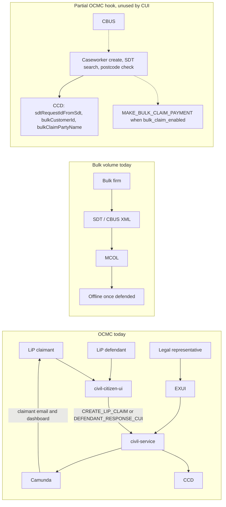
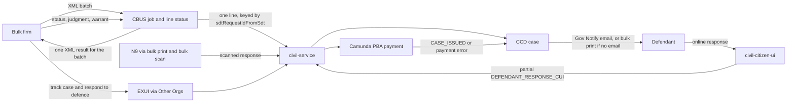

# Spike: Bulk Claims in civil-citizen-ui

Status: discovery findings for team review. This does not implement Bulk Claims and does not record QA completion. The acceptance criteria for this spike stay as written: review the COCC business requirements, document who submits and how defendants respond, assess civil-service and CCD readiness, propose batch and async handling, and estimate scope.

Reviewed 19 November 2026.

| Source | Reference |
| --- | --- |
| Business requirements | [Bulk Claims Business Requirement Document](https://hmcts.atlassian.net/wiki/spaces/COCC/pages/278348402/Bulk+Claims+Business+Requirement+Document) (COCC, page updated 12 October 2026; body includes March 2026 and October 2026 notes) |
| civil-citizen-ui | `b4c839a648` |
| civil-service | `9f2c1f0956` |
| civil-ccd-definition | `bb6edd38d` |
| civil-camunda-bpmn-definition | `e22c82dd` |

Local checkouts were read. Repeat the code sections only if those repos or the BRD scope change.

## Pickup

Classification: discovery-ready. No prerequisite ticket blocks this research.

The BRD describes a programme (access, create, respond, judgment, warrants, queries, breathing space, MI, party transfer, reporting). The ready scope for civil-citizen-ui is narrower: a litigant-in-person defendant responding to a claim that CBUS has already issued. Batch submission, bulk-claimant access, judgments and warrants are civil-service, CBUS and EXUI work. Missing BA and API decisions below are outputs to close. They are not dependencies on unrelated tickets.

## Functional requirements

During 2024/25 about 1.13 million bulk claims were issued on MCOL by about 120 firms, and about 80,000 were defended. The BRD’s goal is to keep those defended cases on OCMC instead of dropping them offline.

### Who submits

Bulk claimants are professional organisations such as utilities and debt issuers, about 110 firms. They are often not legal representatives. They do not submit through civil-citizen-ui and they do not use the citizen claimant journey.

They submit claim, judgment, warrant, query and status-update requests through CBUS (the successor to the MCOL SDT XML channel). After a claim is imported they track it and respond to a defence in EXUI, using the Other Orgs component and Group Access. Other Orgs was noted as due in February 2026. Group Access is required because Access Management otherwise caps an organisation at about 100 cases. CPR changes for non-solicitor organisations are a legal matter and are outside this spike.

civil-citizen-ui is the channel for the defendant when that defendant is a litigant in person.

### What data a bulk claim carries

CBUS and OCMC both validate. OCMC validation stays because the same case model is used for non-bulk specified claims. The create payload is the existing specified-claim mapping, plus bulk metadata:

| Data | Rule from the BRD and current case model |
| --- | --- |
| Parties | One claimant organisation. One defendant, or two defendants. Defendant is treated as a litigant in person at creation. |
| Defendant email | Optional on defendant 1 and defendant 2 (OCCC-141). Mandatory later, only when bulk firms can supply it. Must not break in-flight MCOL creates. |
| Claim amount and interest | Specified money claim. Bulk interest is a daily amount, not the citizen interest screens. |
| Fee and payment | Fee applies. Payment moves from direct debit to PBA (OCCC-121). |
| Request identity | `sdtRequestIdFromSdt` is the idempotency key from CBUS. It is copied onto the `sdtRequestId` collection so a duplicate SDT request is not issued twice. |
| Bulk customer | `bulkCustomerId` identifies the submitting organisation. |
| Party display | `Party.bulkClaimPartyName` holds the name to show when the usual party-name fields are not how the bulk feed names the party. |
| Case number | Caseman case number should use the later values from the MCOL case-number generator (OCCC-122), so MCOL and OCMC numbers can be told apart while both run. |
| Documents | N1SDT is the claim form. Amend and re-serve must stay online. Today, using that form takes the case offline. |

Outstanding mapping issues are recorded on the CMC endpoint mapping page referenced from the BRD. This spike does not invent values for those open mappings.

### How a defendant responds

1. If CBUS supplied an email, Gov Notify emails the defendant and asks them to register. The defendant then responds in civil-citizen-ui.
2. A claim can still be served, and can still be responded to online, when no email is held.
3. Paper response remains. The response form is the N9, not the OCON. Bulk print already sends the N9, so there is no bulk-print change for that swap. A shorter consolidated accompaniment to the N9 is the intended pack. Bulk scan must accept the paper response.
4. On a full or part admission the defendant offers payment terms in OCMC. Judgment by admission is then requested by the bulk claimant over CBUS, not by a citizen claimant in this UI.
5. If the defendant defends, the bulk claimant responds to that defence in EXUI. They do not send that response through CBUS.
6. OCMC must not also email the bulk claimant for each case event. They already receive the CBUS response and can poll with the predefined XML queries. March 2026 note: confirm with bulk users; previous indication is that they do not want individual notifications.
7. Notice of change already exists. For bulk it means the defendant adds a solicitor. The case becomes legally represented and citizen access is removed. A 1v2 case can have one defendant add a solicitor and the other stay unrepresented. That mix needs regression against Group Access. civil-citizen-ui cannot represent it today.
8. Breathing space, default judgment, warrants and settle, discontinue or paid updates arrive from the claimant over CBUS. They are not citizen-ui screens for the bulk claimant. A defendant who is already on a defended case is unaffected by breathing space unless the case is in enforcement.

## Backend readiness

civil-service already has a partial create path. It is behind `bulk_claim_enabled` (`FeatureToggleService.isBulkClaimEnabled`). A new citizen bulk API is not required for the ready scope.

What is already there:

- `POST /cases/caseworkers/create-case/{userId}` submits a caseworker event and returns the created case. CBUS uses this style of call. Failures become a generic `CaseDataInvalidException`.
- `GET /cases/caseworker/searchCaseForSDT/{userId}?sdtRequestId=` searches `case.sdtRequestIdFromSdt` and returns a boolean: true when no case exists.
- `GET /cases/caseworker/validatePin?postCode=` validates a postcode.
- `SubmitClaimTask`, when `sdtRequestIdFromSdt` is present, copies it onto `sdtRequestId`, calculates bulk daily interest, sets the fee from amount plus interest, and selects the first PBA account returned for the user.
- Camunda process `CREATE_SERVICE_REQUEST_CLAIM` branches on `flowFlags.BULK_CLAIM_ENABLED` to external task `MAKE_BULK_CLAIM_PAYMENT`. That handler takes a PBA payment and moves the case to `CASE_ISSUED`.
- `PaymentsService.buildPbaPaymentRequestBulkClaim` pays the claim fee from `claimIssuedPBADetails`, with customer reference `"bulk claim issuer"` and the applicant organisation from `applicant1OrganisationPolicy`.
- `SealedClaimFormGeneratorForSpec` uses bulk interest when the toggle is on and `sdtRequestIdFromSdt` is set.
- `PartyUtils` prefers `bulkClaimPartyName` when it is populated.
- CCD API tests for the SDT create, duplicate check, postcode validation, 1v1 with and without interest, and 1v2 with no interest live under `e2e/tests/api_tests/bulk-claim` in civil-ccd-definition.

What is not ready, and needs API design before build:

- Create is one synchronous case per request. There is no batch resource, job id, or progress resource in civil-service.
- Duplicate check returns only “no match”. It does not return the existing case id, and create is not idempotent if two requests pass the check together.
- PBA selection takes the first account on the user. The BRD needs the account the bulk firm supplied. Organisation id is assumed to be an applicant organisation policy, which is the solicitor shape, not an Other Orgs bulk firm.
- Validation errors are swallowed into one invalid-case exception. CBUS needs per-line, field-level success and failure.
- Defendant email as an optional CBUS attribute is still a BRD change, not something this UI sends.
- No code found that suppresses claimant dashboard or Gov Notify emails because the case is bulk. `defendant_response_cui.bpmn` still raises `CREATE_CLAIMANT_DASHBOARD_NOTIFICATION_FOR_DEFENDANT_RESPONSE`.
- Judgment, warrant, joint judgment and warrant, CBUS read queries, settle, discontinue, paid, breathing space apply and remove, party transfer, and retain-and-dispose are BRD epics. They are not bulk endpoints in the code reviewed.
- CCD load for about a million cases a year is an open platform risk in the BRD (decentralise CCD, or replace OCMC). That decision changes how party transfer is built. It does not block the citizen defendant slice.

## CCD definition

Already on case type `CIVIL`:

| Field | Type | Notes |
| --- | --- | --- |
| `sdtRequestIdFromSdt` | Text | Idempotency key. `Searchable` is `N` in `CaseFieldLRspec.json`, while civil-service queries it. Confirm the search index actually matches before relying on the duplicate check at volume. |
| `sdtRequestId` | Collection of Text | Populated from the SDT id on submit. |
| `bulkCustomerId` | Text | Bulk organisation id. |
| `Party.bulkClaimPartyName` | Text on complex type `Party` | Hidden (`type = "DO_NOT_SHOW"`). |

`AuthorisationCaseFieldLRspec-R2-CUI.json` grants `CITIZEN-CLAIMANT-PROFILE` CRU on `bulkCustomerId`, `sdtRequestId` and `sdtRequestIdFromSdt`. `CITIZEN-DEFENDANT-PROFILE` is not on those three fields. That is acceptable for the defendant journey: civil-citizen-ui submits a partial `caseDataUpdate` and does not need to read or write the SDT key. It is the wrong role if anyone expects a citizen claimant to own a bulk case. Bulk claimants belong on EXUI.

civil-citizen-ui does not map these fields. `CCDParty` has no `bulkClaimPartyName`. The citizen `Claim` model has no bulk flag. Defendant screens will show `partyName` unless a mapper copies `bulkClaimPartyName` when it is the name defendants should see.

Proposed definition changes, only where the citizen slice needs them:

- Treat `sdtRequestIdFromSdt` as the bulk marker. Add `isBulkClaim` only if callbacks and notifications need a flag that survives a cleared request id.
- Keep batch id, line number and job progress out of the case. Those belong to CBUS.
- Give the defendant role read access only if a citizen screen must show a bulk-only field. Do not grant defendant CRU on the SDT key.
- Add an explicit PBA account field on the bulk organisation if `applicantSolicitor1PbaAccounts` cannot represent a non-solicitor firm. Decide this with the payments design (OCCC-121), not in the citizen model.
- Successor claimant and debt-purchaser fields belong to the party-transfer epic, after the data-store decision.

## Architecture

### Current connections

Citizen and legal-representative claims already run on OCMC. Bulk volume still runs on MCOL. A partial OCMC hook exists in civil-service and is not used by civil-citizen-ui. Defended bulk cases leave MCOL and go offline.

Dotted lines are the unfinished mapping from CBUS onto OCMC. civil-citizen-ui has no bulk fields and no batch endpoint. `CITIZEN-CLAIMANT-PROFILE` can update the SDT fields, and `CITIZEN-DEFENDANT-PROFILE` cannot.

### Spike design

CBUS stays the batch boundary. Each line becomes one CCD case. The defendant uses the existing citizen response journey. The bulk firm tracks the case and replies to a defence in EXUI, and reads status from CBUS.

Judgment, warrant and breathing-space requests stay on the CBUS arrow. They do not enter civil-citizen-ui. Claimant emails from Camunda are skipped when `sdtRequestIdFromSdt` is set.

### Batch processing, async work, progress

CBUS is the batch boundary. civil-citizen-ui does not accept a file of claims and does not show batch progress.

Recommended shape:

1. CBUS accepts the XML batch, authenticates the firm, and stores a job: received, validating, processing, completed, with a count of issued, rejected and in-flight lines.
2. CBUS validates the file, then calls civil-service per line. A worker pool limits how many creates and payments hit CCD at once. One line is one CCD case and one Camunda process, which matches `MAKE_BULK_CLAIM_PAYMENT` today.
3. Before create, search by `sdtRequestIdFromSdt`. The API should return the existing case reference when found, and create should use the same key as an idempotency key so a retry cannot issue a second claim.
4. Payment stays asynchronous in the existing Camunda branch. The line stays “payment pending” until `MAKE_BULK_CLAIM_PAYMENT` succeeds or records the PBA error. Do not add a second payment worker in the citizen UI.
5. Progress is queried through the existing CBUS read patterns (request accepted, response received, judgment issued, warrant issued), including across batches by case number. Case-number format distinguishes MCOL from OCMC during dual running.
6. The firm receives one XML result for the batch, not one email per case. Dashboard notifications that target a claimant solicitor must be skipped when `sdtRequestIdFromSdt` is set, until bulk users confirm they want those emails.

### Citizen UI behaviour

For a 1v1 bulk case that is already issued, reuse the current defendant response, admission and directions-questionnaire journey.

- Show the claimant using `bulkClaimPartyName` when that field is set, otherwise the existing party name.
- Do not render `sdtRequestId`, `bulkCustomerId` or PBA details.
- Keep submitting partial updates through `CivilServiceClient.submitEvent` so a defendant response cannot clear bulk metadata.
- Leave claimant response, default judgment and warrant requests off this UI. Those actors are the bulk firm on EXUI or CBUS.
- 1v2 is a separate change. The BRD says civil-citizen-ui is 1v1 only, that upgrading it is significant, and that case state is stored once for the whole case, so one defendant cannot sit in a different state from the other. Set-aside that walks the state backwards can corrupt the state flow. The BRD’s cleaner option is a new event for a retrospective update. That work waits on the funding decision recorded under Approaches: Bulk Claim Dependencies. It does not gate 1v1 defendant response.

## Scope and complexity

| Slice | Where | Size | Notes |
| --- | --- | --- | --- |
| 1v1 defendant response on an issued bulk case | civil-citizen-ui, plus notification guards in civil-service | Small to medium, about 2 to 4 weeks | Display name, no leakage of bulk ids, regression of response and admission, skip claimant emails. Needs one issued bulk case in a preview environment. |
| Finish create so CBUS can rely on it | civil-service, CCD, CBUS | Medium, about 4 to 8 weeks | Idempotent create, structured errors, supplied PBA, optional emails, searchable request id. |
| Bulk claimant on EXUI | Other Orgs, Group Access | Separate | Not this UI. Onboarding cost is mostly certificates and network; registering later staff is still to be agreed. |
| 1v2 defendant response, including mixed litigant and solicitor | civil-citizen-ui and state model | Large, about 8 to 16 weeks and likely more | Blocked on funding and the case-level state problem. |
| Judgment, warrant, queries, breathing space, party transfer, MI, reporting | CBUS, civil-service, enforcement, RTL | Extra large, several epics | Out of this citizen spike. Several BRD rows are still marked blocked (payments, MI tool, email supply, warrant update design). |

Overall complexity for the citizen-ready slice is medium. Complexity for the whole BRD is high. Do not plan them as one civil-citizen-ui delivery.

## Decisions still open

These are the gaps to resolve with BA and API owners. None of them is a reason to invent a dependency on an unrelated ticket.

1. Can bulk firms send defendant email, and for which defendants? Paper response does not wait on this. Digital-first contact does.
2. Which PBA account is charged, and how is a non-solicitor organisation represented on `applicant1OrganisationPolicy`?
3. Confirm bulk firms do not want per-case emails. Until then, claimant notifications for bulk cases should stay off.
4. Is `sdtRequestIdFromSdt` indexed for the duplicate search at batch volume?
5. Case-number range (OCCC-122) so CBUS can route MCOL and OCMC queries.
6. Funding and target system for 1v2 and for set-aside that must stay online.
7. CCD capacity for the yearly volume, recorded in the Bulk Claims Options Analysis. Required before party transfer, not before 1v1 defendant response.
8. Amend and re-serve of an imported claim, online, by the bulk firm in EXUI.

## Future implementation pickup

Start the 1v1 citizen slice when all of these are true:

- `bulk_claim_enabled` is on in the target environment.
- A preview case exists with `sdtRequestIdFromSdt` set, payment completed, state issued, and a defendant who can sign in with the existing email or pin journey.
- The claimant display name rule (`bulkClaimPartyName` versus `partyName`) is agreed.
- Notification owners have agreed that bulk claimants are not emailed from the defendant-response process.

Leave 1v2, EXUI onboarding, judgments and warrants on their own pickups. Re-check this note against the BRD and the four repos above if those change. Do not re-litigate this spike if only unrelated citizen code has moved.
